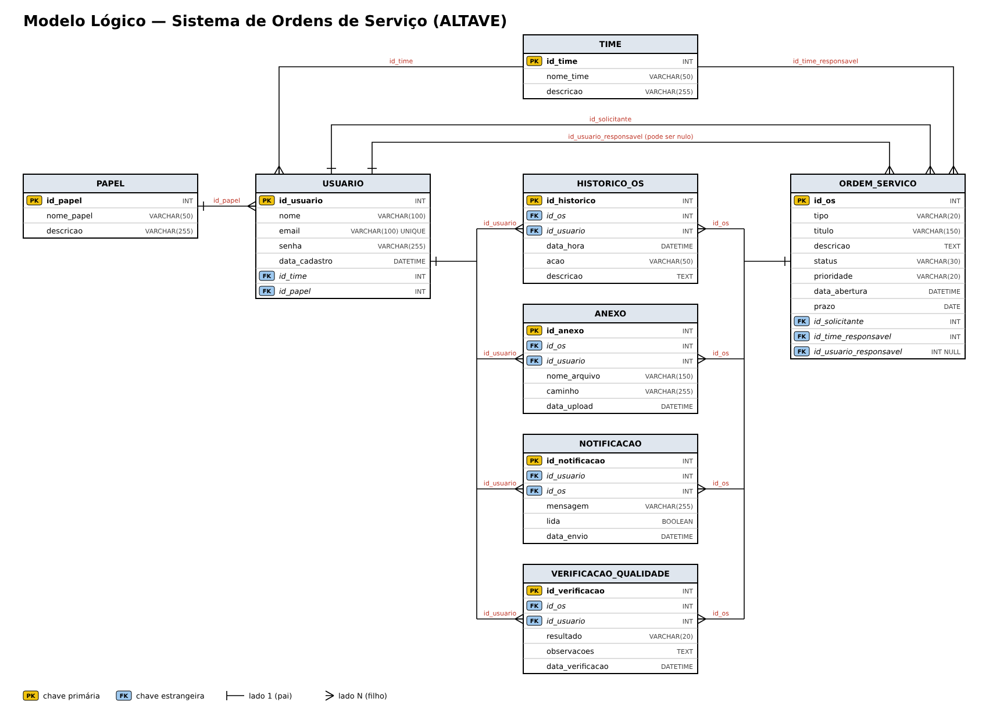
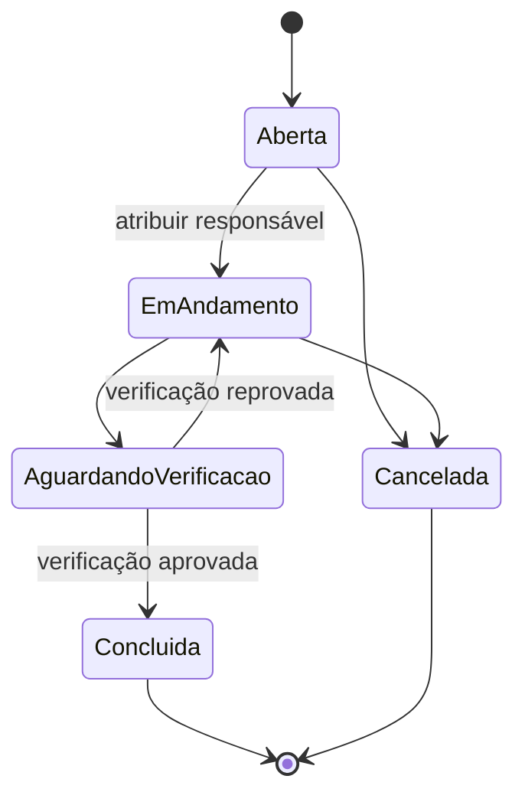

# Sistema de Ordens de Serviço — ALTAVE


Banco de dados relacional e API para o **Sistema de Ordens de Serviço (OS) da ALTAVE**: abertura e acompanhamento de OS entre times, com histórico automático, notificações, fluxo de status validado no banco e verificação de qualidade.

Projeto acadêmico da disciplina de Banco de Dados Relacional (3ª Avaliação), baseado no tema do projeto API da turma.

## Sumário

- [Estrutura do repositório](#estrutura-do-repositório)
- [Como executar](#como-executar)
- [API](#api)
- [Modelo de dados](#modelo-de-dados)
- [Programação no banco](#programação-no-banco)
- [Fluxo de status da OS](#fluxo-de-status-da-os)
- [Testes](#testes)
- [Documentação da avaliação](#documentação-da-avaliação)
- [Autores](#autores)

## Estrutura do repositório

```
.
├── sql/
│   ├── 01_criacao_tabelas.sql   # DDL: banco e 8 tabelas (modelo físico)
│   ├── 02_insercao_dados.sql    # DML: carga inicial (PAPEL 5, TIME 8, USUARIO 60, OS 100, ...)
│   ├── 03_programacao.sql       # 2 views, 6 functions, 6 procedures, 6 triggers
│   └── 04_testes.sql            # consultas para testar toda a programação
├── .gitignore
├── api/
│   ├── server.js                # API Express + mysql2
│   ├── test/api.test.js         # testes de integração (node:test)
│   ├── package.json
│   └── .env.example
├── modelos/                     # modelo conceitual e lógico (PNG, PDF, SVG)
├── docs/
│   ├── Documento_Avaliacao_BDR.pdf / .docx   # documento completo da avaliação
│   └── Dicionario_de_Dados.pdf
└── tools/reset_db.sh            # recria o banco do zero (01 → 02 → 03)
```

## Como executar

**Pré-requisitos:** MySQL 8.0 e Node.js 18 ou superior. Os scripts usam `DELIMITER`, `SIGNAL` e `CURSOR` do MySQL 8 (testado em 8.0).

### 1. Criar o banco

A ordem importa: o script `02` roda antes do `03` para que os triggers não disparem sobre a carga inicial.

```bash
mysql -u root -p < sql/01_criacao_tabelas.sql
mysql -u root -p < sql/02_insercao_dados.sql
mysql -u root -p < sql/03_programacao.sql
```

Para recriar tudo do zero a qualquer momento (Linux/macOS): `MYSQL_PWD=sua_senha tools/reset_db.sh`.

### 2. Subir a API

```bash
cd api
npm install
DB_PASSWORD=sua_senha npm start        # Linux/macOS
```

No PowerShell:

```powershell
cd api
npm install
$env:DB_PASSWORD="sua_senha"; npm start
```

A API sobe em `http://localhost:3000`. Variáveis aceitas (veja `api/.env.example`): `DB_HOST`, `DB_USER`, `DB_PASSWORD`, `DB_NAME`, `PORT`.

## API

A API **não faz INSERT direto**: cada endpoint chama procedures e functions do banco.

| Método | Rota | Objeto do banco | Sucesso |
| --- | --- | --- | --- |
| `POST` | `/os` | procedure `sp_abrir_os` (usa `fn_tecnico_menos_carregado`; triggers geram histórico e notificação) e function `fn_classificar_urgencia` | `201` |
| `GET` | `/times/:id/indicadores` | functions `fn_taxa_aprovacao_time` e `fn_tempo_medio_resolucao_horas` | `200` / `404` |
| `PATCH` | `/os/:id/status` | procedure `sp_alterar_status` (fluxo validado pelo trigger `trg_os_before_update`) | `200` |

**Erros:** campo obrigatório ausente → `400`; regra de negócio violada no banco (`SIGNAL 45000`) ou chave estrangeira inexistente → `422` com a mensagem do banco em `erro`; demais falhas → `500`.

### Abrir uma OS

O `prazo` deve ser hoje ou uma data futura (regra do trigger `trg_os_before_insert`).

```bash
curl -X POST http://localhost:3000/os -H "Content-Type: application/json" \
  -d '{"tipo":"Suporte","titulo":"Teclado com defeito","descricao":"Teclas não respondem","prioridade":"Média","prazo":"2099-12-10","id_solicitante":40,"id_time":1}'
```

```json
{
  "id_os": 101,
  "tipo": "Suporte",
  "titulo": "Teclado com defeito",
  "status": "Aberta",
  "prioridade": "Média",
  "data_abertura": "2026-11-22 21:48:04",
  "prazo": "2099-12-10",
  "solicitante": "Bruno Nascimento",
  "time_responsavel": "TI",
  "tecnico_responsavel": "Nicolas Souza",
  "urgencia": "Normal"
}
```

Valores aceitos: `tipo` (Suporte, Manutenção, Instalação, Compra, Melhoria), `prioridade` (Baixa, Média, Alta, Crítica).

### Indicadores de um time

```bash
curl http://localhost:3000/times/1/indicadores
# {"nome_time":"TI","taxa_aprovacao_pct":"85.71","tempo_medio_horas":"112.4"}   (banco recém-criado)
```

### Alterar o status

Substitua `101` pelo `id_os` devolvido ao abrir a OS (101 é a primeira OS criada em um banco recém-criado).

```bash
curl -X PATCH http://localhost:3000/os/101/status -H "Content-Type: application/json" \
  -d '{"status":"Em andamento","id_usuario":40}'
# {"ok":true}
```

Transição fora do fluxo devolve `422` com `{"erro":"Transição de status não permitida."}`.

## Modelo de dados

8 tabelas: `PAPEL`, `TIME`, `USUARIO`, `ORDEM_SERVICO`, `HISTORICO_OS`, `ANEXO`, `NOTIFICACAO`, `VERIFICACAO_QUALIDADE`.



O modelo conceitual (BRModelo) está em [`modelos/modelo_conceitual.png`](modelos/modelo_conceitual.png) e o dicionário de dados em [`docs/Dicionario_de_Dados.pdf`](docs/Dicionario_de_Dados.pdf).

## Programação no banco

Tudo em [`sql/03_programacao.sql`](sql/03_programacao.sql).

**Views:** `vw_os_detalhada` (OS com solicitante, time e técnico) e `vw_carga_tecnicos` (OS em aberto por técnico).

| Function | O que resolve |
| --- | --- |
| `fn_dias_para_prazo` | dias que faltam ou passaram do prazo de uma OS |
| `fn_classificar_urgencia` | Atrasada, Urgente, Atenção, Normal, Sem prazo ou Encerrada |
| `fn_total_os_abertas_usuario` | OS em aberto de um técnico |
| `fn_taxa_aprovacao_time` | % de verificações aprovadas de um time |
| `fn_tempo_medio_resolucao_horas` | tempo médio entre abertura e conclusão |
| `fn_tecnico_menos_carregado` | técnico do time com menos OS em aberto |

| Procedure | O que resolve |
| --- | --- |
| `sp_abrir_os` | abre a OS em transação e atribui o técnico automaticamente |
| `sp_atribuir_os` | (re)atribui a OS validando que o técnico é do time |
| `sp_alterar_status` | muda o status registrando quem fez |
| `sp_registrar_verificacao` | registra a verificação (só Analista de Qualidade, só OS aguardando verificação) |
| `sp_relatorio_os_por_time` | relatório por time e período, incluindo times sem OS |
| `sp_notificar_os_atrasadas` | alerta técnicos e gestores sobre OS atrasadas, via cursor, sem duplicar no dia |

| Trigger | O que resolve |
| --- | --- |
| `trg_os_before_insert` | valida tipo, prioridade, status, prazo e responsável na abertura |
| `trg_os_after_insert` | histórico de abertura e notificação ao responsável |
| `trg_os_before_update` | garante o fluxo de status e a consistência do responsável |
| `trg_os_after_update` | auditoria de status e atribuição, com notificações |
| `trg_verificacao_after_insert` | aprovação conclui a OS; reprovação devolve para Em andamento |
| `trg_anexo_after_insert` | histórico do anexo e aviso ao responsável |

## Fluxo de status da OS



`Concluída` e `Cancelada` são estados finais. Uma OS só entra em `Em andamento` se tiver técnico responsável.

## Testes

**Banco:** com o banco criado, execute `sql/04_testes.sql` em uma única sessão (as variáveis `@id_os` e `@os2` são criadas ao longo do script):

```bash
mysql -u root -p --force < sql/04_testes.sql
```

Quatro instruções falham de propósito (`SIGNAL 45000`: atribuição a técnico de outro time, transição de status inválida, tipo de OS inválido e alteração de OS encerrada). Com `--force` o script continua após esses erros esperados.

Alguns retornos dependem da data de execução (prazos, atrasos e OS notificadas), então variam de um dia para outro.

**API:** com o banco criado e a variável `DB_PASSWORD` definida:

```bash
cd api
DB_PASSWORD=sua_senha npm test
```

São 8 testes de integração que cobrem abertura de OS, regras de negócio (`422`), campos obrigatórios (`400`), indicadores (`200`/`404`) e fluxo de status. Eles gravam novas OS no banco; use `tools/reset_db.sh` para voltar ao estado inicial.

## Documentação da avaliação

- [`docs/Documento_Avaliacao_BDR.pdf`](docs/Documento_Avaliacao_BDR.pdf) — documento completo (modelos, DML, 6 functions, 6 procedures, 6 triggers com problema, código e retorno, e conexão da API). Versão editável em `.docx`.
- [`docs/Dicionario_de_Dados.pdf`](docs/Dicionario_de_Dados.pdf) — dicionário de dados.

## Autores

- Nícolas de Oliveira
- Matheus Bueno

Professora: Juliana
